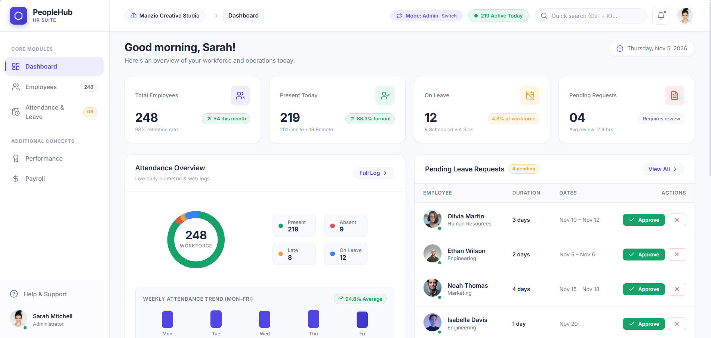
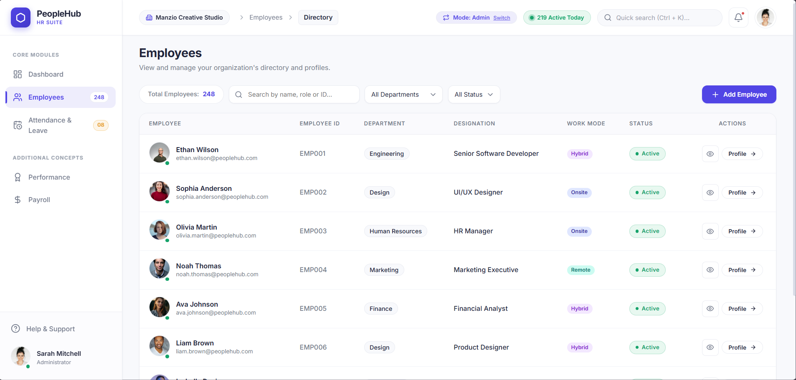
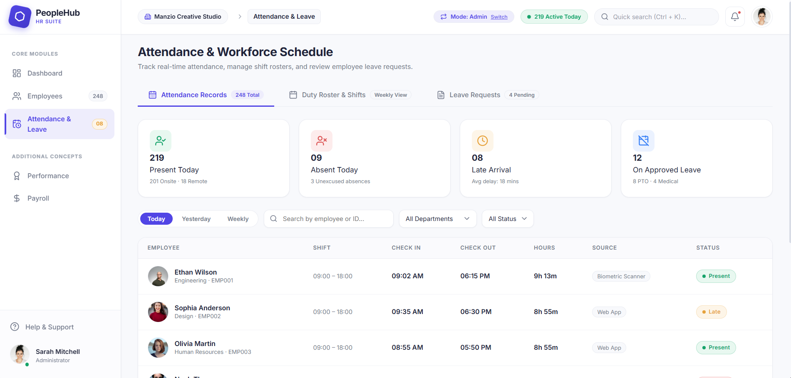

# PeopleHub — HR Management System

A desktop-first HR management interface with a dashboard, employee directory, and attendance and leave management.

**Live demo:** [peoplehub-hr-suite.vercel.app](https://peoplehub-hr-suite.vercel.app)

Built as a UI design assessment for Manzio Creative Studio. The brief asked for three desktop screens, and this project implements them as a working front-end prototype with sample data.

## Preview



| Employee Directory | Attendance & Leave |
| --- | --- |
|  |  |

## Screens

**Dashboard** (`/`)
- Summary cards: total employees, present today, on leave, pending requests
- Attendance overview with a donut chart and weekly trend
- Pending leave requests with inline approve and reject actions
- Recent activity and upcoming events

**Employee Directory** (`/employees`)
- Search by name, email, role, or employee ID
- Filter by department and status
- Slide-over profile preview, so the list keeps its place while you browse
- Add Employee form

**Attendance & Leave** (`/attendance`)
- Attendance tab: check-in and check-out times, check-in method, late badges
- Leave tab: request summary, leave reasons, remaining balances, approve and reject with a confirmation dialog

**Extras:** employee profile page, an admin / employee role switcher, and Performance and Payroll pages.

## Design Approach

- **Clear hierarchy.** A neutral background, white cards, and one accent colour keep the focus on data and actions.
- **Pending work up front.** Leave requests that need a decision sit on the dashboard with one-click actions.
- **Keep context.** Profiles open in a side drawer instead of a new page, so search and filters are not lost.
- **Confirm decisions.** Approving or rejecting a request asks for confirmation and ends with a toast message.
- **Consistent navigation.** A fixed sidebar and a shared header appear on every screen.

Design tokens live in `src/index.css`. The main ones: primary `#5145E5`, background `#F8F9FC`, text `#20243A`, Inter typeface, 8px spacing, 16px card radius. Designed at 1440 × 900.

## Tech Stack

React 19, Vite, React Router, Lucide icons, plain CSS, deployed on Vercel.

## Run Locally

Requires Node.js 18 or later.

```bash
git clone https://github.com/alwinsibym/PeopleHub-HR-Suite.git
cd PeopleHub-HR-Suite
npm install
npm run dev
```

Open `http://localhost:5173`.

## Project Structure

```
docs/
└── screenshots/  README images
src/
├── components/   Header, Sidebar
├── context/      Shared app state (role, leave requests, clock-in)
├── data/         Sample data
├── pages/        Dashboard, Employees, EmployeeProfile, AttendanceLeave, Performance, Payroll, Auth
├── App.jsx
├── main.jsx
└── index.css     Design tokens and global styles
```

## Note

All names, figures, and images are sample content. There is no backend.

---

Designed and built by [Alwin](https://github.com/alwinsibym).
